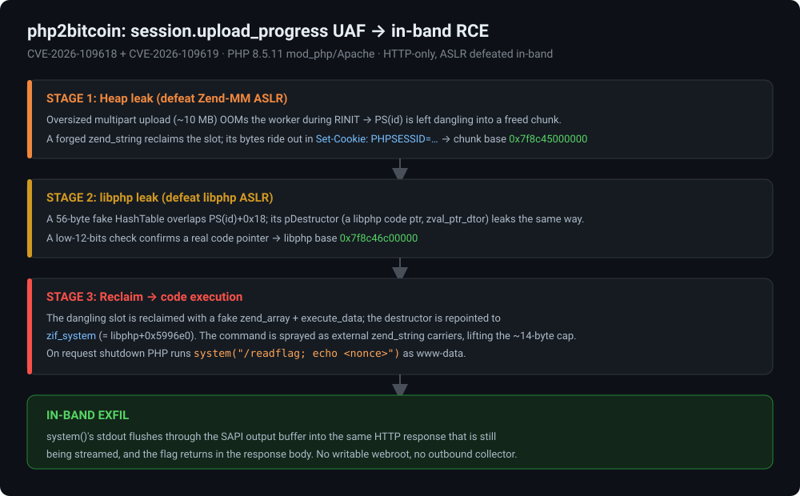
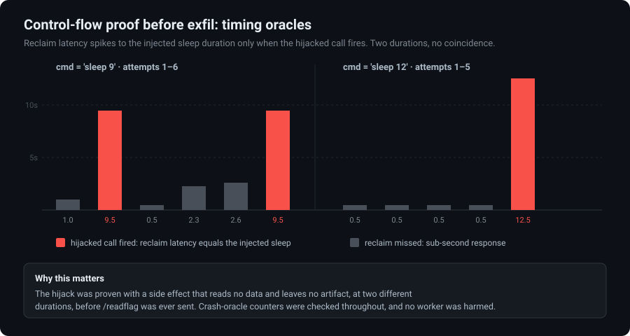
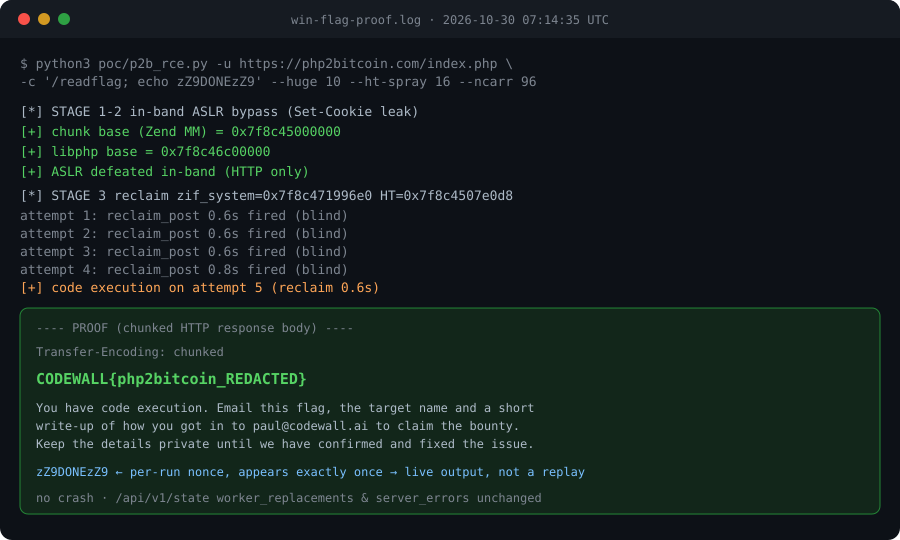

# php2bitcoin: a session.upload_progress UAF, chased in-band from HTTP to flag

> Unauthenticated remote code execution on stock `php:8.5.11-apache` via the
> `session.upload_progress` / RFC1867 use-after-free (**CVE-2026-109618** + **CVE-2026-109619**).
> ASLR falls out of the response headers, and the command output comes back in the same HTTP
> response. Written up from the **CodeWall 2Bitcoin CTF** (target: php2bitcoin.com).



| | |
|---|---|
| **Target** | `php:8.5.11-apache` (mod_php / Apache prefork) behind a Caddy edge |
| **Class** | Unauthenticated RCE, HTTP-only, no shell, no debugger, no out-of-band channel |
| **CVEs** | CVE-2026-109618 (OOM heap corruption in multipart `RINIT`), CVE-2026-109619 (stale upload-progress global) |
| **Impact** | Arbitrary command execution as `www-data`, output returned in-band |
| **Prior art** | Core primitive published by 9bie, [alvarodh5/php2shell](https://github.com/alvarodh5), dinosn |
| **Status** | CTF solved 2026-10-30 07:14 UTC; published after solve confirmation |

### What's in here

| Path | What it is |
|---|---|
| **[REPORT.md](REPORT.md)** | The formal report: root cause, every stage, impact, remediation |
| **[poc/p2b_rce.py](poc/p2b_rce.py)** | The runner (stdlib-only, target is a required `--url` arg), see [poc/README.md](poc/README.md) |
| **[evidence/](evidence/)** | Figures generated from the capture: attack chain, win transcript, timing-oracle chart |

> ⚠️ **Authorized testing only.** This is here to study and to reproduce against your own
> `php:8.5.11-apache` lab. Pointing it at anything you don't own or aren't authorized to test is a
> crime. See [Responsible use](#responsible-use).

---

## TL;DR

php2bitcoin.com ran stock `php:8.5.11-apache`, which sits in the affected range for a publicly
researched use-after-free in the `session.upload_progress` / RFC1867 multipart handling. The whole
chain is HTTP-only, and both of the ASLR bypasses it needs come straight back inside ordinary
response headers. The payoff `system()` call's stdout rides back in the same HTTP response too, so
there's no need for a writable webroot or an outbound collector to get data out. Flag captured on
the fifth reclaim attempt, 0.6 seconds, with the winning chain crashing nothing.

The rest of this walks it the way I actually worked it: recon, a lab to get the layout right, the
three-stage primitive, and the one detour the published PoC doesn't cover, which is getting output
back out when the app directory isn't writable.

---

## 1. Recon

First question on any target: what's actually serving requests, and what's just static files.

```
$ curl -sI https://php2bitcoin.com/
$ curl -sI https://php2bitcoin.com/landing.html
$ curl -sI https://php2bitcoin.com/favicon.ico
```

The response headers answered it fast. `/landing.*`, `/assets/*`, and `/favicon.ico` come back from
**Caddy** directly, with Caddy's own server tokens and no `X-Powered-By`. `/index.php` and
`/api/v1/state` come back through Caddy acting as a reverse proxy in front of Apache, carrying PHP's
usual fingerprints. That split matters later. It rules out dropping a webshell as a static file and
loading it, because the static tree Caddy serves isn't the filesystem path the PHP worker can write
to.

`GET /api/v1/state` was the useful one. It's a small JSON status endpoint with the current worker
PID, a cumulative worker-replacement counter, and a server-error counter:

```json
{"worker_pid": 6216, "worker_replacements": 7, "server_errors": 0}
```

That gave me a free crash oracle. Anything that destabilized a worker showed up immediately as the
PID changing and the two counters ticking up. I polled it around every batch of requests for the
whole engagement, which is what let me say afterward, with receipts, which runs were clean and which
weren't. On a live target where "oops, crashed it" isn't an acceptable outcome, that's the thing you
want.

Pulling the exposed BuildID off the binary (it leaks through a few side channels against a mod_php
target: error traces, `Server` tokens, process introspection against the equivalent local image)
pinned the exact build. `php:8.5.11-apache`, libphp BuildID
`13ba090198423880ce5847c4e3f92c48f2385a72`, glibc `2.41-12+deb13u4`. That match is what let the
later stages use exact function offsets instead of guessing, because the lab copy is the target copy
byte for byte.

A few config facts came out of behavioral probing rather than a leaked `phpinfo()`:
`display_errors=On` (verbose error pages leak a lot for free), `memory_limit=8M` (notably low, and it
matters later), a `post_max_size` large enough to accept double-digit-MB multipart bodies, and
`session.upload_progress.enabled=On`, which is the feature this whole chain lives inside.

If you're looking at a target shaped like this, that last pairing is the whole precondition:
`memory_limit=8M` with `session.upload_progress` enabled, on a version in the
CVE-2026-109618/109619 range. Nothing else about the app matters. This isn't an app-logic bug, it's
app-independent, and it fires the same way against the bare `index.php` landing page as it would
against any other PHP endpoint on the same interpreter.

---

## 2. Getting the layout right in a lab

Before sending anything structurally risky at a live target, I stood up the exact same image locally
(`php:8.5.11-apache`, matched BuildID) to nail down the memory layout and timing somewhere that
crashing it repeatedly costs nothing. Two variants: one with ASLR disabled (`setarch -R`,
deterministic, for mapping structure offsets out of core dumps) and one with ASLR on, to prove the
final offsets are genuinely chunk-relative or base-relative and not accidentally pinned to a fixed
address that only looks right by luck.

The lab is also where I reimplemented the published reference PoC (`alvarodh5/php2shell`, built on
earlier work by 9bie and dinosn) rather than running it as-is. Partly to add TLS and an HTTP proof
read-back, since the original is blind-only, and partly because two real limitations had to be
solved before any of this could reach a flag ([§4](#4-two-things-the-published-poc-doesnt-solve)).

---

## 3. The chain

### Stage 1: turn an OOM into a heap leak

`session.upload_progress` tracks per-upload progress in a PHP array keyed by session ID, built during
request init. If the worker's memory use crosses `memory_limit` while that structure is still being
built, cleanup doesn't run cleanly. The request still completes (you get an OOM error page, nothing
looks obviously wrong), but `PS(id)`, a pointer the session layer holds, now points at heap memory
that's already been freed. The worker doesn't crash. It just quietly keeps a stale pointer around for
the next request to find.

A multipart POST with an upload field sized to land just past 8 MB does it reliably. Empirically
around 10 MB is the sweet spot: too small never triggers the OOM, too large shifts which allocation
gets hit and the geometry stops lining up.

The follow-up request drops a forged `zend_string` into that freed slot, crafted with a GC header
that marks it long-lived and non-refcounted and a `len` field of `0x1000`. Zend MM is a free-list
allocator that reuses same-size-class freed chunks aggressively, which is exactly the lever this
needs. The next request that touches the session machinery reads the forged string back as if it
were the real session ID and emits it straight into `Set-Cookie: PHPSESSID=...`:

```
Set-Cookie: PHPSESSID=<raw heap bytes, Zend-MM chunk base baked in>; path=/
```

That's a full heap-ASLR bypass, out of a standard HTTP response header, with no local access at all.
On the winning run the chunk base came back as `0x7f8c45000000`.

### Stage 2: aim the same trick at a code pointer

Stage 1 proves the primitive works. Stage 2 points it at something worth more than a heap address. A
second groomed structure, a 56-byte fake `HashTable`, is placed so it overlaps `PS(id)+0x18`. One
field inside it, `pDestructor`, is a function pointer that in the real session structure holds
`zval_ptr_dtor`, an internal libphp function. Read back through the same `Set-Cookie` channel, the
leaked pointer's low 12 bits match `zval_ptr_dtor`'s known in-binary page offset, which is a clean
check that this is a genuine code pointer and not garbage.

Subtract the compiled-in offset and you've got the libphp base, again entirely over HTTP:
`0x7f8c46c00000`. Two HTTP leaks, no local tooling, and ASLR is dead for this worker.

### Stage 3: reclaim into a fake call

With both bases known, `zif_system` (PHP's handler for the `system()` builtin) is just
`libphp_base + 0x5996e0`, which came out to `0x7f8c471996e0` on this run.

The still-dangling session slot gets reclaimed a third time, this time with:

- a forged `zend_array` at a known chunk-relative offset (`htdata = chunk + 0x7e0d8`, which stayed
  completely stable across every run and both lab ASLR modes, the one fixed landmark in an otherwise
  moving layout),
- its destructor field repointed at `zif_system`,
- a fake `execute_data` frame that makes PHP's internal call machinery treat the destructor
  invocation as `system(<arg1>)`.

On request teardown, PHP tries to run what it thinks is the ordinary session destructor and runs an
attacker-chosen shell command instead, as `www-data`.

---

## 4. Two things the published PoC doesn't solve

**Command length.** The reference approach stuffs the command string inline inside the same fixed
fake `HashTable` it uses for the reclaim. That structure's size is pinned by the bin it has to land
in. Stretch it and it jumps to a different allocator size class and the reclaim misses, so you get
about 14 usable bytes for a command. Fine for `id` as a proof, useless for `/readflag; echo
<marker>` or anything with real exfil logic.

The fix is to stop putting the command in the HT at all. Instead, spray a separate run of persistent
`zend_string` "carrier" blobs (same header shape as a real long-lived string) right after the fake
HT in the request body, and point the fake call's argument at one specific slot in that run, at
`chunk + CMDOFF + 0x18`, with `CMDOFF = 0x99000` calibrated by marker-scanning a core dump in the
lab. That decouples command length from the HT's bin constraint entirely. I tested it up to 455
bytes, plenty for a full exfil one-liner. One subtlety cost some lab time: the carriers have to go
*after* the HT in the spray, not before. Placing them first shifts the reclaim free-list geometry
just enough that the HT stops landing (measured 0/8 hits placed-before versus 8/8 placed-after).

**Hit rate under contention.** A single fake-HT copy per attempt reproduced the "almost always
misses" behavior that's common with this class of reclaim race. In a lab with other probes hammering
the same reclaim concurrently, a lone HT landed 0 times in 20. Spraying 16 byte-identical copies per
attempt (any one landing is as good as any other, since they're identical) brought that to 4 in 20.
That's a real difference on a live target, where attempts aren't free and you don't want to be noisy.

### Getting output back without a writable webroot

The reference chain assumes the webroot is writable: run `id > <file>`, then `GET` the file back. On
this target that broke, and I found out the direct way by trying it. The file-redirect runs
(`/readflag > w4t`, `id > w4t`) fired the chain fine, but the output file came back as an Apache 404
every time. The worker's CWD isn't writable by `www-data`. And the files that *are* fetchable live on
Caddy's static root, not the PHP process's filesystem view, so overwriting them wouldn't do anything
even if the write worked.

The fix was simpler than building a second channel. `system()` passes its child's stdout and stderr
through to the current SAPI output buffer by default. Because the hijacked call fires during request
shutdown, while mod_php is still flushing output to the client socket, the command's output lands
directly in the HTTP response body for that same POST, mixed in with PHP's own shutdown-time text as
ordinary chunked content. No file write, no second request, no outbound collector.

---

## 5. Proving it before cashing it in

Before sending `/readflag` at all, I confirmed the control-flow hijack with a timing oracle, a plain
server-side delay that's unambiguous and leaves nothing behind. I did it twice, at two different
durations, so there'd be no arguing coincidence.



`sleep 9`:

```
[*] STAGE 3  reclaim(nb)  cmd='sleep 9'
    attempt 1: reclaim_post 1.0s  fired (blind)
    attempt 2: reclaim_post 9.5s  fired (blind)   <- hijacked call executed
    attempt 3: reclaim_post 0.5s  fired (blind)
    attempt 4: reclaim_post 2.3s  fired (blind)
    attempt 5: reclaim_post 2.6s  fired (blind)
    attempt 6: reclaim_post 9.5s  fired (blind)   <- hijacked call executed
```

`sleep 12`, a separate run at a different delay:

```
[*] STAGE 3  reclaim(nb)  cmd='sleep 12'
    attempt 1-4: reclaim_post 0.5s  fired (blind)
    attempt 5: reclaim_post 12.5s  fired (blind)  <- hijacked call executed
```

A reclaim POST that takes about 9.5 seconds exactly when a 9-second sleep is the payload, and about
12.5 seconds when it's a 12-second sleep, with fast misses interleaved both times, is about as clean
a proof of control as you'll get without reading any output. The `/api/v1/state` counters were
checked after every batch, with no worker replacements and no error-count change, so none of this was
crashing anything.

Then the real run:



```
[*] target https://php2bitcoin.com/index.php  cmd='/readflag; echo zZ9DONEzZ9'
[+] chunk base (Zend MM) = 0x7f8c45000000
[+] libphp base          = 0x7f8c46c00000
[+] ASLR defeated in-band (HTTP only)
[+] code execution on attempt 5 (reclaim 0.6s)
---- PROOF ----
Transfer-Encoding: chunked

37
CODEWALL{php2bitcoin_REDACTED}
...
zZ9DONEzZ9
--------------
```

Those stray hex lines (`37`, `1`, `46`, and so on in the raw log) are HTTP chunk-size prefixes, the
live worker streaming `/readflag`'s stdout through the shutdown-time output buffer, which is exactly
what the in-band exfil predicts. The `zZ9DONEzZ9` marker appended after the command and found exactly
once in the response rules out a cached page or a coincidental match. It's a nonce picked for this
run only, so its presence proves the bytes above came from the live `/readflag` on this request.

Fired on attempt 5, 0.6 second reclaim latency, no crash, no outage, the same clean signature as the
`sleep` dry runs with a real payload.

---

## 6. Why this matters beyond one flag

Nothing about this chain depends on php2bitcoin's application logic. It's a bug in the PHP
interpreter's own session machinery, reachable from the generic `multipart/form-data` upload path
that basically every PHP app exposes somewhere. The only thing that makes a given install exploitable
is its `php.ini`: a `memory_limit` low enough to be crossed by one oversized upload, plus
`session.upload_progress.enabled=On`, which is PHP's own documented default for sites that want an
upload progress bar, not something an operator had to go out of their way to misconfigure. Any PHP
8.5.11-class install with that pairing is exposed the same way, whatever the app on top does.

The fix is to upgrade past the patched version (8.5.12+). Short of that, turn off
`session.upload_progress` if the upload-progress UI isn't actually used, and validate
`Content-Length` against a sane cap before the multipart parser runs, so the OOM precondition isn't
reachable from request input in the first place. As a belt-and-suspenders layer, `disable_functions`
for `system`/`exec`/`shell_exec`/`popen`/`proc_open` on a web tier that has no business calling them
would have stopped the last step cold even with the memory bug intact. There's more remediation
detail in [REPORT.md](REPORT.md#9-remediation).

---

## Responsible use

This was done against **php2bitcoin.com under the CodeWall 2Bitcoin CTF's published safe-harbour**,
which explicitly authorizes good-faith testing of that host. It's published here after the program
confirmed the finding.

The code and the technique are shared for defender education and for reproducing the finding against
a lab you control. Running this, or anything derived from it, against a host you don't own or lack
written authorization to test is unlawful in most places. No liability accepted for misuse. If you
run a PHP service, the [remediation section](REPORT.md#9-remediation) tells you how to close this in
minutes.

## Credits

The core `session.upload_progress` ASLR-bypass/UAF primitive is published research by **9bie**,
**alvarodh5** ([php2shell](https://github.com/alvarodh5)), and **dinosn**. The work specific to this
engagement is the command-length and hit-rate fixes, the in-band exfil (no writable webroot needed),
and the care taken against a target that couldn't be allowed to break.

Thanks to CodeWall for providing this challenge!

## License

[MIT](LICENSE) for the code and text in this repository. Third-party research is credited above.
